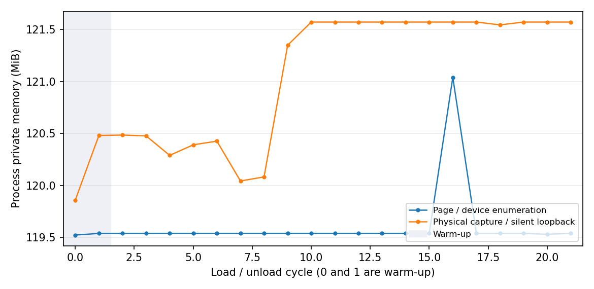

# 插件运行依赖分离

当前应用 0.4.1、API 0.4；客户端入口／生命周期 IID /3.0，服务端入口 /2.0。封装格式独立于 C++ ABI。Windows x64 客户端和 Linux 服务端是本轮交付范围；Linux 客户端、macOS 媒体部署未验证。

## 使用安装后的 SDK

主程序和两端 SDK 首次更新后，Windows 插件单独执行：

~~~powershell
& ./.agent/skills/ztgui-build/scripts/build-plugin-windows.ps1 -PluginDirectory src/plugins/voice-chat/client -Target ztgui_voice_chat -QtRoot $qtSdk -ApiSdk dist/ZTGUI-api-v0.4
~~~

可指定 BuildDirectory、OutputDirectory。入口只配置独立插件，明确使用安装 SDK 的 ZTGUIPluginApi_DIR，构建业务目标与显式 package 目标；验证 SDK 文件哈希和源码输入，缺失或过期时停止，不自动构建主程序。正式发布只包含 .ztplugin 和对应可读许可证目录。

SDK helper 保持旧参数可用，增加 RUNTIME_QT_MODULES、RUNTIME_FILES、LICENSE_FILES。文件参数使用包内路径=源文件路径；仅 Windows 支持私有运行库，其他平台遇到相应声明立即报错。模块的动态插件类别取自 Kit 的 MODULE_PLUGIN_TYPES，特殊工厂插件可用 RUNTIME_FILES 显式声明。宿主/SDK 不查找 Multimedia，只有声明该依赖的插件查找与部署。

POST_BUILD 与 <target>_package 使用同一文件锁；显式目标每次重新收集、检查导入闭包并用 QSaveFile 原子封装，业务 DLL 未重新链接也能更新依赖。正式 install 不安装裸 DLL/SO。Windows 收集对本次 DLL 在干净暂存目录调用匹配 Kit 的 windeployqt，关闭翻译、QML 扫描和调试工具，保留声明模块的后端及实际可达依赖，排除宿主基础库、系统/CRT、基础 QPA/控件插件。第三方运行库必须显式声明，不从主程序 dist 或封装工具目录猜测。

## 宿主 Kit 契约与许可证

HostRuntimeContract.cmake 由宿主与独立 SDK 共用。客户端基础模块为 Core、Gui、Network、Qml、Quick、QuickControls2、Widgets、Concurrent；服务端为 Core、Network。Windows 递归 PE 导入计算基础 Qt DLL 集合，qtBuildId 是原始 Kit 文件名及 SHA-256 排序后的哈希，计算发生在 windeployqt 修改任何副本之前。宿主嵌入 Release/Debug 契约；SDK 安装两种契约及根 host-runtime-contract.json、sdk-tools.json（格式支持、工具内容指纹、安装文件和源码输入哈希）。

带私有 Qt 模块或 Qt 工厂后端的包匹配完整 Qt 版本和 qtBuildId；普通包仍按 Qt 主次版本匹配。平台、架构、编译器 ABI、Debug/Release、API 与 IID 继续校验。覆盖宿主基础库、系统 DLL、CRT 或 libsodium 的包被拒绝。

收集器从实际 Kit 的 licenses/ 取得 Qt/媒体许可证，Opus 许可证由插件声明。FFmpeg 分发还要求 licenses/FFmpeg/actual-build.json，记录实际二进制导出的 av_version_info、avutil_configuration、avutil_license 和 binaries 文件 SHA-256；收集器核对这些哈希。缺许可证或与二进制不符时停止，不能用另一份系统 FFmpeg 的许可证代替。本机 Qt 6.8.3 Kit 的实际 FFmpeg 是 7.1，构建配置与 LGPL 描述已经记录；许可证取自对应 Qt/FFmpeg 源码版本。

## v2 格式和加载寿命

ZTPK2\\n + 大端 JSON 长度 + 原始 UTF-8 JSON + 按 files 顺序的加密块。每个明文块上限 1 MiB（空文件一个空块）；每块独立随机 24 字节 nonce、XChaCha20-Poly1305 和 16 字节标签。AAD 为原始 JSON + 大端文件索引 + 大端块索引。JSON 上限 1 MiB、512 文件、单文件 256 MiB、总明文 512 MiB；根据大小推导精确容器长度，拒绝截断、尾随数据和超限。

路径、角色、唯一入口、平台规范化重名、文件/目录冲突、全部块认证和逐文件 SHA-256 验证通过后才允许加载。拒绝穿越、绝对路径、ADS、设备名、链接/junction；宿主设置输出权限。inspect 不缓存密文；v2 流式读写/提取，v1 因单块旧格式仅在实际提取时分配旧单文件缓冲。共享格式密钥不证明发行者身份。

工具支持 --inspect <包>、--list <包>、--extract-licenses <包> --output <目录>。导出只复制完整认证的许可证，绝不加载代码。新工具默认写 v2，新宿主保留 v1 读取；v1 不补装媒体依赖，只接受已经由宿主目录提供的额外库并保持进程级句柄；缺依赖时提示使用新 SDK 重编。旧 JSON 中偶然含有 files/runtime 等 v2 字段也不解释为文件清单。

业务文件每次进入独立 load-* 目录；运行依赖按其文件清单与契约指纹在本进程的 runtime-* 目录复用。入口/业务资源更新不改变运行指纹。Windows 用 SetDefaultDllDirectories、AddDllDirectory 和依赖优先的绝对路径 LoadLibraryExW 预加载普通运行库；Qt 后端由 Qt 工厂加载，QCoreApplication 库路径保留到进程结束。不修改工作目录、PATH、QT_PLUGIN_PATH 或 QQmlEngine 导入路径。

同名同哈希复用；同名不同哈希、无法证明兼容的已加载外部模块在业务入口执行前拒绝，提示匹配构建/重启。预加载前失败清理未激活目录；任何运行依赖加载后保留目录、句柄和锁到进程退出。另一进程的活动锁阻止陈旧缓存清理。

保留原生命周期顺序。QPluginLoader 必须先设置空加载标志，再设置文件名：Qt 6.8 在关联文件后只能 OR 标志，反过来的调用不能清除默认 PreventUnloadHint。客户端核对 Windows 业务模块实际离开映射；卸载失败保留业务目录/锁。媒体句柄不在 QApplication 析构前 FreeLibrary，退出后的遗留运行目录在下次启动清理。

## 验证记录

2026-10-14，Windows 11 x64、MSVC 2022 19.44、Qt 6.8.3 Release；WSL Ubuntu 24.04、GCC 13.3、Qt 6.4.2。版本、API、IID 均保持计划指定值。

| 产物 | 文件数 / 包内数 | 原始大小（字节） | 压缩包（字节） |
| --- | ---: | ---: | ---: |
| Windows 主程序 | 191 | 60,692,925 | 26,346,612 |
| 客户端 SDK | 43 | 8,110,500 | 3,472,132 |
| Linux 主程序 | 4 | 740,693 | 277,508 |
| 服务端 SDK | 27 | 288,166 | 93,923 |
| Windows 语音 v2 包 | 29 | 20,908,606 | 单文件交付 |
| Linux 语音 v2 包 | 1 | 98,370 | 单文件交付 |

语音客户端包为 1 个入口、6 个运行库、2 个后端、20 个许可证/出处文件；不带基础 Qt、系统/CRT 或 libsodium。Linux 语音只有业务入口，系统 Qt 不再分发，因此本包没有新增运行库许可证。最终发布哈希见[产物记录](validation/plugin-runtime-artifacts-2026-10-14.json)。三份 ZIP 的 CRC 与逐文件内容和发行目录一致，发布 EXE/插件包与对应构建产物一致，两端 SDK 安装文件/源码输入指纹有效。

- Windows 容器测试 10 项、加载/生命周期测试 14 项通过；包含 v1 实际加载、v2 多文件/空文件、多块和块顺序认证、元数据/正文篡改、精确长度、路径/大小写冲突、NTFS junction 输入和许可证输出拒绝、上限校验、Qt 契约错误、宿主库覆盖、缺导入、运行库复用和不同哈希冲突。
- Windows 干净目录只从新宿主包复制基础文件，并单独提供 Qt6Test.dll；清除开发 Kit PATH、QT_PLUGIN_PATH、QML_IMPORT_PATH、QML2_IMPORT_PATH。未加载插件时进程没有 Multimedia；实际加载的 Multimedia 和 FFmpeg 后端来自 runtime-* 私有目录。页面、设备枚举（2 输入/2 输出）、三级音量、静音、连接/断开、卸载和重载通过。
- 2 轮暖机加 20 轮页面加载/卸载：入口 DLL 每轮真正离开映射，线程数保持 14，运行目录 1 个、预加载句柄 6 个。两个相同可执行文件的并发进程也分别完成该循环，未互删活动缓存；陈旧目录由后续启动回收。
- Windows 到本机 WSL 测试服务的 TCP/UDP 使用 WSL 虚拟网卡地址，避免 NAT localhost 只转发 TCP。双页面入房/退房通过。另完成 2 轮暖机加 20 轮真实设备采集、Opus 编码、服务端回送、解码和物理输出设备启动/写入：每轮收到至少 10 个真实麦克风帧，退出房间、断开和热卸载通过；运行目录和预加载句柄保持 1 / 6。总输出增益为 0，未发送到外部服务器、未保存录音，也未用合成音频代替实机采集。
- Linux 容器/查询两个测试目标、通用宿主集成 5 项、语音服务集成 5 项通过；v1/v2 工具读写和真实服务端包加载已验证。
- 两端 SDK 解压到仓库外，拷贝各自示例源码独立配置/编译；客户端示例 package 目标、Linux 独立语音 package 目标均通过。修正 Qt find_dependency 改写 PACKAGE_PREFIX_DIR 的旧问题，封装工具路径现在保留 SDK 自身前缀。Linux 解压器必须保留 bin/ztplugin_pack 的可执行权限；Python ZipFile 提取会丢失权限，测试显式恢复后验证。
- 同一个主程序分别在存在/临时移走语音构建缓存时打包，两份文件清单均为 191 个，均没有 Multimedia、FFmpeg、multimedia 后端或业务包。每次正式部署前也检查这些禁止项。
- 仅运行独立语音脚本：主程序 EXE、ZIP、发行目录及两端 SDK ZIP 的 194 项 SHA-256 全部不变。显式 package 目标每次收集，业务 DLL 不需要重新链接；失效清单/缺文件不会发布旧包。

页面循环暖机后的私有内存约 119.5–121.0 MiB；实际录放音循环约 120.0–121.6 MiB，末几轮达到平台；曲线和原始数据如下。仅反映本机本轮样本，不能把第二次初始化更快或后端常驻解释成无泄漏保证。Qt 媒体后端保留的是进程内存基线。

原始数据：[页面/枚举](validation/plugin-runtime-idle-2026-10-14.csv)、[实际录放音](validation/plugin-runtime-audio-2026-10-14.csv)。

未完成：多人可听输出、耳机/扬声器听感与长时间通话质量验收；Linux 客户端及 macOS 媒体部署。零增益回送证明实际采集、编码、传输、解码和输出设备写入路径，不能证明可听音质。上述项目没有标记为通过。

Qt 加载标志的依据见[Qt 6.8.3 QLibrary 实现](https://raw.githubusercontent.com/qt/qtbase/v6.8.3/src/corelib/plugin/qlibrary.cpp)；应用级媒体后端见[媒体集成实现](https://raw.githubusercontent.com/qt/qtmultimedia/v6.8.3/src/multimedia/platform/qplatformmediaintegration.cpp)，DLL 搜索目录规则见[Microsoft AddDllDirectory](https://learn.microsoft.com/en-us/windows/win32/api/libloaderapi/nf-libloaderapi-adddlldirectory)。
