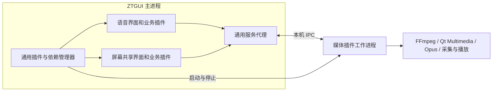

# 独立插件、服务依赖与媒体进程隔离：Agent 实施交接

状态：本轮已按用户授权实施框架、独立媒体服务及语音迁移；屏幕共享仅验证通用依赖机制。日期：2026-10-15。本文保留设计与验收要求，当前契约及实测证据见 [服务实现](plugin-services.md)。未创建远端仓库或对外发布。

编写时基线为客户端 `0.4.1`、客户端 API `0.4`（现为客户端 `0.5.1-alpha`／API `0.5-alpha`，服务端 `0.2.1-beta`／API `0.2-beta`），客户端入口／生命周期 IID `/3.0`。实施前重新读取实际 `VERSION`、`SERVER_VERSION`、`AGENTS.md`、工作区状态及相关技能，不能将本文的基线版本当成新的版本分配指令。

## 1. 用户已确认的目标

1. 所有插件都是独立项目，可以脱离主程序源码构建和发布。宿主不包含插件实现，也不因增加某种插件而重新链接其业务代码。
2. 插件可以拆成开发用 API SDK 和运行用服务实现。例如媒体插件发布媒体 API SDK，供语音、屏幕共享插件编写功能。
3. 语音和屏幕共享在编译期引用媒体 API，在运行期通过宿主管理的服务访问媒体插件，不直接链接媒体实现 DLL。
4. `.ztplugin` 基本信息显式声明前置插件、版本约束和必需服务接口。宿主在执行插件代码前解析完整依赖图；依赖齐全、兼容并就绪后才初始化使用者。
5. 插件列表分别显示媒体、语音、屏幕共享三个条目；加载按依赖顺序，卸载按反向依赖顺序。服务插件可以没有侧栏页面。
6. 加载、停止和等待期间 GUI 持续响应，插件菜单只在就绪时启用。
7. 三个插件全部卸载完成后，主进程不再映射这些插件的业务 DLL、FFmpeg、Qt Multimedia 及媒体后端；媒体工作进程退出，媒体专用资源全部释放。

最初设计轮用户选择的是“只确定架构与验收规则，暂不修改代码”；本轮 `/goal` 已明确授权迁移，并确认屏幕共享仅验证依赖机制。屏幕共享目前没有实现，后续不能把测试夹具或空页面称为已完成的屏幕共享插件。开始实施时，应结合用户当时指令确认是否包含其采集、传输和观看业务；框架阶段可以用依赖夹具验收调度。

## 2. 原设计时的实现与需要替换的约束

| 位置 | 当前行为 | 后续方向 |
| --- | --- | --- |
| `src/client/api/include/ztgui/PluginApi.h` | `PluginInfo` 没有依赖／服务声明 | 包清单承载静态声明；公开接口提供通用服务访问能力 |
| `src/client/api/include/ztgui/HostServices.h` | 只有文件、ZeroTier 和日志服务 | 增加通用服务发现、租约、异步调用及状态通知契约 |
| `src/client/main/plugins/PluginRegistry.cpp` | 要求至少一个菜单 | 支持无菜单的服务插件；列表目录不依赖菜单注册表 |
| `src/client/main/plugins/PluginLoader.cpp` | 每个包独立异步加载；没有依赖调度 | 保留后台包处理，增加依赖图、加载事务和反向卸载 |
| `src/shared/package/PluginRuntime.cpp` | 私有运行库进入主进程并保留到退出 | 新媒体方案完全走工作进程，不能调用旧主进程媒体激活路径 |
| `src/shared/package/PluginBundle.cpp`、`PackageTool.cpp` | v1/v2，入口被当成 Qt 动态插件 | 增加能够区分进程内插件与工作进程服务的新清单语义 |
| `src/shared/package/HostRuntimeContract.cmake` | 基础 Qt 契约服务于进程内 ABI | 区分宿主 ABI 与工作进程自己的运行环境／IPC 契约 |
| `src/shared/package/PackagePlugin.cmake`、`CollectPluginRuntime.*` | 基于业务 DLL 收集依赖，排除宿主基础库 | 区分进程内入口与工作进程入口，分别收集正确的依赖闭包 |
| `src/plugins/voice-chat/client/` | 自己使用 Qt Multimedia、静态 Opus，包含设备缓存和音频引擎 | 设备、采集播放、编解码迁至媒体服务；界面、房间及网络业务使用媒体 API |
| `src/tests/plugins/VoicePluginTests.cpp` | 断言媒体库进入主进程并在多轮后常驻 | 新方案增加相反的模块检查，并验证媒体工作进程寿命 |

现有插件已有独立 CMake 项目，但源码仍放在宿主仓库；这不等于已完成独立仓库与安装后 SDK 的验证。

设计时项目技能 `.agents/skills/ztgui-plugin-dev/SKILL.md` 写有“禁止插件互相依赖、引用或调用”，并要求运行依赖保留到进程退出。用户本次明确提出新的受宿主管理的显式服务依赖架构。后续实施应同步更新对应规则，限定为通过公开 API 和宿主服务访问，继续禁止包含其他插件的私有实现头或私自查找其对象。

已完成的 v2 运行依赖分离由 [现行说明与验收记录](plugin-runtime-separation.md) 维护。当前“运行库保留到进程退出”是既有实现，本方案的独立媒体进程是后续架构目标；不能把后续目标误写成当前已支持的行为。

## 3. 架构与项目边界



媒体插件是插件目录中的一个逻辑插件，首版建议实现成单独的服务进程，不需要再在主进程加载一个媒体适配 DLL。主程序使用通用进程管理与 IPC 代理，不能内置 `media`、`voice-chat`、`screen-share` 分支。

编译期 API 与运行期实现分别交付：

| 交付物 | 包含 | 不应包含 |
| --- | --- | --- |
| 宿主插件 SDK | 生命周期、通用服务租约／调用、基础协议、封装工具 | 媒体算法、FFmpeg 或 Qt Multimedia 依赖 |
| 媒体 API SDK | 服务标识、版本、DTO、客户端调用封装、IPC 消息定义、CMake 导出 | 媒体实现 DLL、FFmpeg 头文件／对象、`QAudioDevice` 等媒体类型 |
| 媒体 `.ztplugin` | 服务声明、工作进程及其完整运行依赖、许可证 | 主程序的实现头／源码 |
| 语音／屏幕共享 `.ztplugin` | 各自界面、业务、依赖声明；可以嵌入媒体 API 客户端封装 | 媒体服务实现、FFmpeg／Qt Multimedia／媒体后端的直接或延迟导入 |

媒体 API 可依赖宿主公开 SDK 和必要的基础 Qt 类型。所有对象跨进程表示为会话 ID、请求 ID、数据描述或受管理共享内存句柄，不能传递裸指针、虚函数对象或依赖 FFmpeg 布局的结构。

插件目标布局示意如下；这些是未来独立项目，不是现存目录，也不是新仓库的远端地址：

```text
<media-repo>/api/                 # 可独立安装的媒体 API SDK
<media-repo>/service/             # 工作进程与媒体引擎
<media-repo>/docs/
<voice-repo>/client/              # 仅引用已安装的宿主 SDK、媒体 API SDK
<screen-share-repo>/client/
```

独立项目可以暂存于现有 `src/plugins/<plugin>/` 进行迁移，但最终必须证明复制到宿主仓库之外后仍可只用安装 SDK 构建。实际迁移到其他仓库／路径需要用户提供目标；不能擅自创建远端、删除原项目或改写其历史。

## 4. `.ztplugin` 元数据与兼容性

以下 JSON 是待实现的契约草案，省略现有平台、文件、哈希和构建字段。示例版本不分配宿主新版本。

媒体包示意：

```json
{
  "id": "media",
  "version": "1.0.0",
  "execution": {
    "kind": "worker-process",
    "entry": "service/media-worker.exe",
    "protocol": "ztgui-service/1"
  },
  "dependencies": [],
  "provides": [
    {"service": "media.audio", "api": "1"},
    {"service": "media.video", "api": "1"}
  ]
}
```

语音包示意：

```json
{
  "id": "voice-chat",
  "execution": {"kind": "in-process", "entry": "plugin/plugin.dll"},
  "dependencies": [
    {
      "pluginId": "media",
      "versionRange": ">=1.0.0 <2.0.0",
      "services": [{"service": "media.audio", "api": "1"}]
    }
  ],
  "provides": []
}
```

屏幕共享使用相同机制依赖 `media` 和 `media.video`。插件版本、宿主 API/ABI、服务接口版本、IPC 协议版本、容器格式版本分别校验，不能把它们混成一个数字。

首版采用必需依赖、一个规范化插件 ID 对应一个已安装版本、依赖图无环的模型。暂不增加可选依赖、多提供者选举或同 ID 多版本并存。版本范围应使用明确、可测试的语义版本规则；遇到不支持的表达式直接报告错误。

必须解决旧宿主忽略新字段的问题。推荐新增容器版本标识（例如 `ZTPK3\n`），继续沿用经过验证的分块认证方法，使旧宿主拒绝新语义包。不能只给 v2 添加 `dependencies` 后仍允许旧宿主忽略它并执行业务入口。最终容器版本与字段定稿需记录在 API／格式文档和测试中。

依赖、服务声明和执行模式必须纳入认证数据。发现包时可以显示尚未验证的基本信息，但只有完整认证与路径／哈希验证通过后，才能将声明用于可执行加载计划。Qt 插件元数据／运行期声明必须与认证包一致；工作进程必须通过握手证明其协议和服务能力符合清单。

保持既有容器的路径、链接／junction、大小、数量、截断、尾随数据及防篡改检查。加密格式的共享密钥不代表发行者签名。

旧包兼容与完整卸载保证必须分开处理：不依赖媒体的旧插件可以按原 ABI 规则继续支持；直接在主进程加载媒体库的旧语音包不能作为新媒体服务架构的兼容回退。进入新模式时，应明确拒绝这些旧媒体包并提示迁移／重编。如果当前进程已经经由旧路径加载了常驻媒体库，需要重启到干净进程，不能仅更新目录状态就宣布媒体映射已清除。

## 5. 宿主服务模型

宿主维护通用服务目录：提供者插件 ID、服务 ID、接口版本、提供者实例代次、就绪状态，以及使用者的租约。媒体 API 的类型化客户端封装在独立 SDK 中，宿主不需要包含媒体 API 头文件才能管理服务。

服务只在提供者就绪后发布。消费者只能获取其清单已声明的服务，并且只能选择已解析到的提供者。租约绑定消费者实例；不能使用全局裸指针长期缓存提供者。

引用管理至少分别记录：

- 已就绪或正在初始化的依赖者持有的依赖占用。
- 用户主动加载提供者产生的保留意图。
- 活动会话、在途调用、回调及共享缓冲所持有的资源占用。

仅统计已加载插件数不足以决定能否卸载。会话关闭和回调排空也必须完成。引用释放要幂等，并使用提供者／消费者代次拒绝旧实例迟到的消息，避免卸载后重新加载时串用旧会话。

加载和卸载完成事件必须区分“已受理”和“已完成”；提供者进程退出、资源关闭及模块核对尚未结束时，不能先报告卸载成功。

## 6. 依赖加载事务

1. 后台扫描并验证包；按不区分大小写的规范化 ID 建目录，拒绝重名。目录中未加载插件也可显示基本信息和依赖错误。
2. 对用户目标计算完整传递依赖闭包，校验缺失项、版本、服务、平台及宿主能力；以三色 DFS 等方法拒绝循环并报告完整链。
3. 任何业务代码执行前完成依赖计划。即使 `QPluginLoader::load()` 还没创建 QObject，也可能执行动态库初始化，因此不能提前预加载消费者 DLL。
4. 按拓扑顺序加载依赖。独立分支可并行，消费者必须等待其所有前置服务就绪。
5. 工作进程完成启动／握手／服务准备后，提供者进入 Ready。仅进程启动成功不等于服务就绪。
6. 依赖就绪后才加载消费者业务 DLL，创建其 GUI 对象并执行初始化；后台任务结束后启用菜单。
7. 重复加载同一节点合并为一次节点操作，但分别记录请求者的占用。加载／卸载竞争由同一状态机协调，不能并发修改注册表。
8. 失败或取消时，清理失败节点，逆序回滚本事务新启动且已无其他占用的节点；不得卸载事务开始前已经运行或被另一事务获取的插件。

“存在时才加载”表示已安装包可解析且兼容。首版不自动联网下载依赖，也不从路径环境变量或其他插件私有目录猜测缺失库。

自动加载应区分安装状态、持久禁用和本次自动启动。用户主动加载消费者可请求启动其普通前置依赖；若提供者被明确持久禁用，先报告阻止原因，不能后台悄悄清除禁用设置。启动扫描也不能绕过禁用状态。后续若加入“一并启用依赖”操作，必须作为明确的用户操作展示。

## 7. 反向卸载与异步停止

卸载叶子消费者时：禁止新业务 → 发出停止请求 → 释放媒体会话并排空在途操作 → 退出页面／销毁控制器与工厂 → 最终生命周期清理 → 卸载业务 DLL → 核对实际模块映射。

现有 `onDestroy()` 和页面析构不适合承担长时间等待。应设计公开的异步停止阶段，使 `onDestroy()` 只做已停止状态下的最终清理；正常路径不得在 GUI 线程同步等待工作线程或子进程。接口具体名称由实现定稿，顺序与非阻塞要求不可省略。

| 操作 | 必须遵守的行为 |
| --- | --- |
| 卸载语音，屏幕共享仍运行 | 关闭语音会话并卸载语音 DLL，媒体进程与屏幕共享会话继续运行 |
| 卸载屏幕共享，语音仍运行 | 对称处理，不能停止共享媒体提供者 |
| 用户卸载媒体插件 | 先展示级联影响范围，执行时逆拓扑卸载所有传递依赖者，再停止媒体进程 |
| 自动启动的媒体已无使用者 | 无用户主动保留意图、无会话／在途占用时，可自动卸载 |
| 用户单独主动加载的媒体已无使用者 | 保留其加载意图，直到用户卸载媒体或执行全部卸载 |
| 全部卸载／程序退出 | 先停止接收新加载操作，再逆拓扑停止消费者和提供者 |

语音和屏幕共享互不依赖，两者之间没有强制的先后次序；它们都必须先于媒体结束。

某个消费者清理失败时，不得继续正常卸载它仍使用的提供者，也不得声称整个级联已经完成。保留必要的对象／库和错误状态，明确展示哪个节点阻塞。超时不能作为强行卸载仍执行中主进程 DLL 的依据。

媒体进程停止应先优雅关闭全部会话并退出。若需要强制结束超时的工作进程，只能针对宿主确实拥有的进程及其子进程树，等待确认退出后释放 IPC／共享内存，报告强制终止结果。此行为不能推广成强行卸载主进程中的消费者 DLL。

## 8. 媒体进程、IPC 与数据通道

工作进程及其依赖由媒体包完整携带，不能要求主程序发布目录预装媒体 DLL。宿主只认证、提取并启动已验证入口，不能对工作进程包调用 `QPluginLoader`、`activateRuntime()`，也不能将其库目录加入主进程的 Qt 或 DLL 搜索路径。

工作进程拥有自己的运行环境。收集器必须按其实际可执行文件及后端收集闭包；必要的 Qt Core／Network 等基础库可以随工作进程部署，不能照搬“进程内插件禁止重复宿主基础 Qt”的排除规则。不要向任意插件开放覆盖宿主库的能力；两种执行模式要有独立的校验路径。

媒体进程中的 Qt 环境、工作目录和 DLL 搜索设置仅作用于子进程；不修改宿主或系统的 PATH、QT_PLUGIN_PATH、QML 导入路径。进程内插件继续遵守匹配宿主 Qt／编译器／ABI 的要求；工作进程按自己的运行环境与 IPC 协议验证，不能误用宿主 Qt 插件 IID 作为可执行文件的入口校验。

建议每个已加载媒体提供者实例对应一个工作进程，多消费者使用独立会话。IPC 使用本机连接、每次启动的连接凭据和协议握手，绑定宿主拥有的进程实例。所有调用异步，消息长度、待处理数量和超时有界；崩溃或断连后批量完成／取消旧请求，禁止悬挂回调。

控制命令与音视频数据通道分离。视频帧可使用有界共享内存环形缓冲，携带格式、尺寸、步长、时间戳及帧序号；验证尺寸计算、防止越界，并明确生产者／消费者释放协议。不要将连续原始视频帧编码成 JSON/Base64 在 GUI 事件线程中转。首版可以使用 CPU 帧通道，GPU 跨进程共享及同步另做平台专项验证。

后续语音迁移应把设备枚举、默认设备选择、采集／播放、Opus 编解码、混音／重采样所需媒体实现放入工作进程。保持现有房间、网络协议、音量语义和配置兼容，除非用户另行要求改变；语音界面只接收不含媒体对象的设备描述及状态。

媒体进程异常退出时，先使其服务和实例代次失效，依赖插件进入明确的不可用／失败状态，停止相关会话并使 GUI 可恢复。重新启动不能复用旧会话；不能在未确认恢复策略的情况下自动恢复录音或屏幕采集。

Windows 要有宿主退出／崩溃后的进程树清理机制，例如正确配置的 Job Object；其他平台实现等价的所有权和父进程丢失处理。工作进程隔离是生命周期和故障边界，不应被宣传成安全沙箱。

## 9. GUI 与“完全清理”的定义

插件列表分别显示已安装的媒体、语音、屏幕共享，以及版本、提供的服务、前置依赖、被谁使用、当前状态和错误原因。媒体插件没有菜单也必须可见。缺包时不伪造已安装插件，可在消费者条目显示缺少哪项依赖。

建议状态至少包括：未加载、被禁用、校验中、等待依赖、加载中、就绪、停止中、被依赖者阻塞、失败。按钮按状态决定可用性；重复操作不创建重复进程，其他页面保持可操作。卸载、删除插件包和删除用户数据必须保持不同语义。

本目标中的“完全没有媒体相关代码”按以下可观察结果验收：

- 主进程没有媒体提供者／语音／屏幕共享业务 DLL 的可执行映射。
- 主进程没有 FFmpeg 各库、Qt Multimedia、媒体后端及其他随媒体包引入的第三方引擎映射；名称应从实际清单取值，不能只写死某版 FFmpeg DLL 名。
- 属于该媒体实例的工作进程和子进程树均已退出，无活跃媒体会话、专用线程／任务、IPC 连接、共享缓冲或 GPU 共享句柄。
- 已释放对应活动锁和提取缓存的占用；短暂文件删除失败可以有界重试并报告状态，但不能因此把仍存活的进程视作已卸载。
- 没有主进程 Qt 全局 QML 类型／单例或延迟回调继续引用已卸载插件代码。沿用现有页面／工厂／引擎组件缓存清理规则。

主程序的基础 Qt、通用服务代理和图形显示代码允许保留。进程总内存数值不要求逐字节回到启动值；通用分配器、图形驱动和操作系统缓存不能直接当成媒体库残留。模块映射／进程／资源所有权证据是主判据，不能仅用任务管理器内存下降或 `QPluginLoader::unload()` 返回值证明通过。

## 10. 实施阶段与交付边界

1. **契约与兼容策略**：定稿依赖语义、执行模式、容器格式、通用服务 API、异步停止接口、IPC 和版本规则；先建立容器与依赖图测试。
2. **通用宿主支持**：实现无菜单服务插件目录、后台加载事务、服务租约、工作进程管理、逆向停止及 GUI 状态。使用独立消费者／提供者夹具，不添加媒体 ID 特判。
3. **独立媒体项目及 API SDK**：可独立安装 API、构建服务进程、封装完整依赖，先验证设备查询和会话创建／关闭以及进程寿命。
4. **语音迁移**：消除语音 DLL 的直接／延迟媒体导入，迁移实际设备与编解码行为，保持已有业务兼容并完成真实音频验证。
5. **屏幕共享接入**：按用户授权范围开发；只有实际采集、传输、解码和观看经过验证后，才报告完整业务交付。此前测试夹具只证明框架能力。
6. **安装 SDK 的独立构建与发行**：插件在宿主仓库外构建；发布物分离；更新相关接口、维护说明和技能。

应用版本由开发者分配，不自动改 `VERSION` 或 API 核心代际。公开接口若改变 C++ 布局／虚表，不能保持旧 IID 后声称二进制兼容；可评估新增独立接口或更新 IID，并明确旧插件的拒绝／重编策略。发布新版本仍需要开发者另行指定版本号。

本设计不自动授权构建全部插件、改变服务端协议、实现完整屏幕共享、拆分到远端仓库或发布。共享包代码变化时，需验证客户端和服务端旧格式兼容；Linux 服务端不承担本轮客户端媒体服务实现。Windows x64 作为首个交付平台，其他平台按实际验证说明，不能默认宣称支持。

## 11. 验收矩阵

| 场景 | 必须证明 |
| --- | --- |
| 未加载任何媒体相关插件 | 主进程无媒体模块、无媒体工作进程，主程序发行包不带媒体依赖 |
| 构建独立插件 | 只使用安装后的宿主 SDK／媒体 API SDK，无宿主源码路径或私有头依赖 |
| 缺失／错误版本／禁用前置依赖 | 消费者代码未执行，报告完整依赖链，不擅自下载或解除禁用 |
| 自依赖、传递循环、规范化重名 | 在任何业务入口执行前拒绝，错误可定位到包 |
| 首次加载语音 | 媒体先握手就绪，语音后初始化；GUI 心跳持续，菜单就绪后才可点击 |
| 再加载屏幕共享消费者 | 只有一个媒体提供者进程，两类会话独立；不能只用空页面验收屏幕共享业务 |
| 卸载其中一个消费者 | 另一消费者的实际会话持续运行，媒体进程不退出 |
| 显式卸载媒体 | 影响范围准确；依赖者先完成停止，再结束提供者；没有悬空服务 |
| 消费者停止失败／超时 | 不错误释放仍被使用的提供者，不报告全部卸载成功 |
| 初始化失败、加载取消和并发请求 | 只回滚本事务可回收资源，不误伤既有／并发使用者，无重复进程或重复完成事件 |
| 加载与停止时退出宿主 | 按顺序异步结束，无 GUI 阻塞、悬挂任务或孤儿工作进程 |
| 媒体工作进程崩溃 | 服务失效、请求终结、消费者可恢复；旧代次消息不进入新会话 |
| 三个插件全部卸载 | 模块、进程树、会话、IPC、缓冲和句柄全部满足第 9 节 |
| 重新加载／多轮循环 | 每轮得到新实例代次，可正常使用；进程、线程、句柄和专用缓冲不逐轮累积 |
| 新旧包交叉使用 | 旧宿主明确拒绝新语义包；新宿主不把旧常驻媒体路径误报成可完全卸载 |
| 主程序及 SDK 打包 | 主程序不包含媒体组件；插件及媒体 API 分别交付；许可证与实际二进制匹配 |

自动化检查放在 `src/tests/`；独立插件测试由其项目维护，宿主仓库可保留通用协议与集成夹具。按测试隔离用户插件、配置和录音／屏幕数据，不能删除用户已有的运行目录。

Windows 实测需要同时检查宿主模块和工作进程模块，记录 PID、模块路径／哈希、进程树、线程／句柄及共享资源数量。建议最少进行 2 轮暖机和 20 轮加载／使用／卸载，逐轮检查第 9 节；另覆盖并发加载和故障路径。真实音频／屏幕业务验证不能仅用模拟数据或模块存在替代，应记录设备、目标、环境和未验证条件。

不使用不匹配的 offscreen 部署代替原生 Windows 点击验收。依赖加载、错误状态、取消、级联卸载和主题切换期间的控件状态需要实际验证；后台处理大包仍须保持已有的界面响应能力。

## 12. 后续 Agent 开工与交付检查

- 先读取本文件、根约定、`docs/plugin-api.md`、`docs/plugin-runtime-separation.md`，以及实际 `PluginLoader`、`PluginRegistry`、包验证／收集器和语音实现；不要根据旧评估文档猜测当前异步行为。
- 修改／构建插件时读取项目插件开发技能；实际改动 QML 时读取对应界面技能；构建／打包时读取项目构建技能。仅文档任务不触发构建。
- 查看并保留已有未提交改动。不要把与本方案无关的成员 ICMP 等改动纳入实现或提交；不能执行重置来清理工作区。
- 依实现范围同步更新技能中的依赖禁止／运行库寿命规则，以及 API、包格式、构建和迁移文档。未分配版本的功能记录在 CHANGELOG 未发布部分。
- 区分通用夹具通过、实际插件可加载、实际音频／视频业务通过；缺少条件的测试明确标注跳过，不能写成已验证。
- 交付列出各独立项目／SDK 的位置、实际构建命令、主程序与插件产物、版本／IID／格式迁移、测试证据和剩余限制。不要仅凭菜单消失就报告完整卸载实现完成。

## 13. 从早期能力评估保留的边界

以下是仍有价值的设计边界，不表示本方案额外实现文件传输或通用任务中心：

- 长期会话的寿命不应由当前是否显示页面决定。当前语音会话由缓存页面持有，菜单切换不会销毁页面；迁移时要明确会话、服务租约与页面分别由谁持有，并保留既有切换行为。
- `PluginFiles` 是整文件读写工具，适合配置和小型缓存；未来大文件传输需使用流式 IO、自有协议和有界缓冲，不能先 `readAll()` 再调用文件工具。进度／失败通知、暂停和恢复属于额外业务能力。
- ZeroTier 节点／网络快照与已有同 ID 数据订阅不等于语音、共享或文件传输服务发现。不要把 peers 列表当作应用在线联系人；应用会话和对端能力仍需明确的发现／信令协议。
- 数据目录目前绑定显示名，改名需要迁移策略；设备／录屏权限、应用身份和签名则需要在实际媒体工作进程及目标平台上验证，不能用宿主已有权限声明代替。
